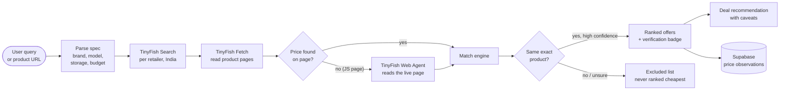

<div align="center">


# PricePilot AI

### Search Smarter. Compare Better. Pay Less.

AI-powered shopping intelligence and real-time price comparison for Indian shoppers, built on [TinyFish](https://tinyfish.ai) web agents.

[](https://github.com/Cod4Nitish/pricepilot-ai/actions/workflows/ci.yml)


**[Live demo](https://pricepilot-ai-sigma.vercel.app)** &nbsp;|&nbsp; **[API docs](docs/API.md)** &nbsp;|&nbsp; **[Architecture](docs/ARCHITECTURE.md)** &nbsp;|&nbsp; **[Deploy](docs/DEPLOYMENT.md)**

</div>

---

## Why PricePilot?

Comparing prices in India means opening five tabs, squinting at EMI numbers, and wondering whether the "256GB" listing is really the same phone. PricePilot sends **real browser agents** to the retailers for you, checks that every listing is the **exact same product**, and shows you only prices it actually read from the page, each with a visible **verification level**.

> **The rule we never break:** no fabricated prices, no invented history, no fake deals. If a store can't be read, PricePilot says so.

## Screenshots

<!--
Add images to docs/screenshots/ and replace the lines below, e.g.
  
-->

| Landing | Search results | Price comparison |
|:---:|:---:|:---:|
| _coming soon_ | _coming soon_ | _coming soon_ |

| Smart basket | AI assistant | Installed app |
|:---:|:---:|:---:|
| _coming soon_ | _coming soon_ | _coming soon_ |

## How it works (workflow)



1. **Parse**: the query becomes a structured spec (brand, model, storage, RAM, colour, condition, max price).
2. **Search**: TinyFish Search runs against each supported retailer (`location=IN`, domain-restricted).
3. **Fetch**: TinyFish Fetch reads the product pages (markdown) and the extractor pulls price, MRP, availability and offer text, keeping a short verbatim evidence string.
4. **Agent fallback**: JavaScript-heavy pages with no readable price are opened by a TinyFish Web Agent with a strict output schema (capped per request to protect your credits).
5. **Match**: a strict matcher rejects wrong storage, wrong generation, `Ultra`/`FE`/`Plus` variants and refurbished-vs-new. Uncertain matches are shown separately and excluded from the "cheapest" ranking.
6. **Verify and explain**: every offer carries a badge, and the recommendation lists its caveats (bank-offer conditions, unknown delivery charges, thin evidence).
7. **Remember**: genuinely observed prices are stored in Supabase so history charts and alerts are real.

## Verification levels

| Badge | Meaning |
|---|---|
| `verified` | Price read from the retailer's product page via TinyFish Fetch |
| `agent_verified` | Price read from the live page by a TinyFish Web Agent |
| `snippet_only` | Seen only in a search snippet, not confirmed on the page |
| `unverified` | Could not be confirmed, shown without a price claim |

## Features

| Feature | Needs |
|---|---|
| Universal product search (text, "under ₹X" budgets, pasted product URLs) | `TINYFISH_API_KEY` |
| Live price comparison across Amazon India, Flipkart, Croma, Reliance Digital, Vijay Sales | `TINYFISH_API_KEY` |
| Honest per-retailer status (ok, partial, blocked, no results, error) | `TINYFISH_API_KEY` |
| Strict AI product matching with confidence scores | none (logic) |
| Smart deal recommendation with caveats | `TINYFISH_API_KEY` |
| Smart Basket optimizer (store split, delivery thresholds) | `TINYFISH_API_KEY` |
| AI shopping assistant that triggers real searches | `ANTHROPIC_API_KEY` + `TINYFISH_API_KEY` |
| Price history (7/30/90 days) from real observations | Supabase |
| Watchlist and target-price alerts | Supabase |
| Installable PWA with offline shell and timestamped cache | none |
| Scheduled price refresh endpoint | `CRON_SECRET` + Supabase |

Without server configuration the API returns `503 NOT_CONFIGURED`. It never falls back to sample data.

## Spend less, decide better: purchase cost AND research cost

PricePilot optimizes both what the shopper pays and what the AI web research costs to run.

### TrueCost (`src/lib/engine/ecommerce/truecost.ts`)

`payable = listed price + verified fees - confirmed discounts`, with four honest states:

| State | Meaning |
|---|---|
| `CONFIRMED` | every required charge is known: this is the payable total |
| `LOWER_BOUND` | e.g. shipping not shown: the total is a **minimum**, never treated as ₹0 shipping |
| `CONDITIONAL` | total known, plus card/coupon offers that need an eligibility check at checkout (never deducted, never stacked) |
| `UNKNOWN` | listed price not verified |

"Cheapest Confirmed" is awarded only to a verified, exact-variant, in-stock offer with a fully known total. Otherwise the UI shows "Lowest Listed Price" and "Lowest Known Minimum" separately and says there is no confirmed winner.

### Deal Decision Receipt (`src/lib/receipts/build.ts`)

Built only from the completed comparison (no extra TinyFish calls): product, variant, per-retailer price + verification time + source link, TrueCost status, verdict and reason, evidence quality, limitations, research cost. Copy, download JSON, or native share. Nothing is stored server-side.

### Cost-aware adaptive agent routing (`src/lib/search.ts`, `src/lib/tinyfish.ts`, `src/lib/cost/*`)

`Cache → TinyFish Search → TinyFish Fetch → paid TinyFish Agent only when justified.`

- The Agent runs only for a page whose price Fetch could not read, whose title strongly matches the query, at a relevant retailer that has no verified price yet.
- It **stops early** once 2 retailers have verified, in-budget prices, and says so in the result ("a lower price elsewhere is possible").
- Identical concurrent searches share one in-flight pipeline. Cache keys are normalized but keep every variant token.
- Caches are separate: product discovery (6 h), agent price observations (15 min, shown with their original time and labelled "cached"), product identity (24 h).
- "Re-check prices now" forces a live check (TinyFish Fetch `ttl: 0`).
- Budgets are set by env: `PP_AGENT_MAX_PER_SEARCH` (2), `PP_AGENT_MAX_CONCURRENT` (2), `PP_AGENT_DAILY_MAX_RUNS` (100), `PP_AGENT_DAILY_BUDGET_USD` (2), `PP_AGENT_MAX_DURATION_S` (75), `PP_TARGET_VERIFIED_RETAILERS` (2), `PP_PRICE_TTL_S` (900), `PP_USD_PER_AGENT_STEP` (0.016), `PP_COST_ALERT_USD` (1), and `PP_ROUTING=legacy` for A/B testing. Timeouts bound run time, not money: the daily budget is checked before each run, so one run can overshoot it by its own steps.

**Telemetry.** Every response carries `usage`, which shows the real counts: Search requests, fetched URLs, paid agent runs, the provider-metered `num_of_steps`, cache hits, latency and verified retailers. `GET /api/cost` gives aggregate counters for the server instance; there are no queries, IPs or keys in it. Cost is **calculated** as steps × $0.016 (TinyFish wallet rate card, 2026-11-01; Search and Fetch are $0). It is not a billing record; the actual bill is in the TinyFish dashboard.

### Measured A/B, same 3 queries, real TinyFish (localhost, 2026-11-01)

| Routing | Paid agent runs | Agent steps | Calculated cost | Time per query | Verified retailers (S24 / phone<50k / laptop<70k) |
|---|---|---|---|---|---|
| legacy (before) | 6 | 43 | $0.688 | 110 to 177 s | flipkart / none / amazon + vijay* |
| adaptive (after) | 0 | 0 | $0.00 | 11 to 21 s | amazon + flipkart / none / amazon + vijay* |

\* In both runs the laptop "verified" prices were wrong (₹3,199 = a free-gift value, ₹25,000 = return-policy text). This was found during the A/B and fixed afterwards: retailers whose fetched page has no price now trust only structured prices. The same query re-run after the fix: 2 paid agent runs, 12 steps, $0.192 calculated, and **no verified laptop within ₹70,000**, which is reported honestly. One run per query; retailer search results vary between runs, so treat these as a single sample, not a benchmark average.

Also found and fixed during the sprint: TinyFish began rejecting `description` keys in Agent `output_schema` (HTTP 400). That had silently disabled every Agent fallback; schemas are now sanitized.

## Supported retailers

| Retailer | Discovery | Price extraction |
|---|---|---|
| Amazon India | TinyFish Search | Fetch |
| Flipkart | TinyFish Search | Fetch |
| Croma | TinyFish Search | Web Agent fallback (page is JS-rendered) |
| Reliance Digital | TinyFish Search | Fetch / Web Agent, product-page filtered |
| Vijay Sales | TinyFish Search | Fetch / Web Agent, product-page filtered |

A retailer that cannot be read is reported as unavailable instead of being guessed.

## Tech stack

Next.js 15 (App Router) · TypeScript (strict) · Tailwind CSS 4 · Motion · TanStack Query · Recharts · Zod · Supabase (Postgres + Auth + RLS) · TinyFish Search / Fetch / Agent · Anthropic Claude · PWA (manifest + service worker) · Vercel

## Quick start

```bash
git clone https://github.com/Cod4Nitish/pricepilot-ai.git
cd pricepilot-ai
npm install
cp .env.example .env.local   # then fill in your own values
npm run dev
```

Open http://localhost:3000. `GET /api/health` shows which integrations are configured (booleans only, never secrets).

## Environment variables

| Variable | Scope | Purpose |
|---|---|---|
| `TINYFISH_API_KEY` | server | TinyFish Search / Fetch / Agent |
| `ANTHROPIC_API_KEY` | server | AI shopping assistant |
| `SUPABASE_URL` | server | Supabase project URL |
| `SUPABASE_SERVICE_ROLE_KEY` | server only | Privileged DB access. Never expose to the client |
| `NEXT_PUBLIC_SUPABASE_URL` | client | Supabase URL for browser auth |
| `NEXT_PUBLIC_SUPABASE_ANON_KEY` | client | Public anon key (protected by RLS) |
| `CRON_SECRET` | server | Authorises scheduled refresh calls |

Never commit real values. `.env*` files are gitignored.

## Supabase setup

1. Create a project at supabase.com.
2. Apply the SQL files in `supabase/migrations/` in filename order (SQL editor, or the CLI):
   ```bash
   npx supabase link --project-ref <your-ref>
   npx supabase db push
   ```
3. Copy the project URL, anon key and service role key into your environment.
4. Confirm Row Level Security is enabled on user tables.

## Install as an app (PWA)

- **Android (Chrome)**: open the site, tap the menu (three dots), then **Install app**.
- **iPhone (Safari)**: tap **Share**, then **Add to Home Screen**, then **Add**.
- **Desktop (Chrome / Edge)**: click the install icon in the address bar, then **Install**.

Offline, the app opens its shell and shows cached data with timestamps. It never presents cached prices as live.

## Security

- API keys are read server-side only and never shipped to the browser.
- User-supplied URLs pass SSRF checks and an allow-list of retailer domains before any automation runs.
- Per-IP rate limiting, request timeouts, retries with backoff, concurrency caps and an agent-run budget protect usage costs.
- Supabase Row Level Security isolates user data.

See [SECURITY.md](SECURITY.md).

## Scripts

| Command | Action |
|---|---|
| `npm run dev` | Dev server |
| `npm run build` / `npm start` | Production build / serve |
| `npm run lint` | Lint |
| `npm run typecheck` | `tsc --noEmit` |
| `npm test` | Unit tests (vitest) |
| `npm run icons` | Regenerate PWA icons |

## Limitations

- Prices come from public pages and can change or be blocked; always confirm at checkout.
- `snippet_only` and `unverified` offers are not confirmed prices.
- Delivery cost appears only when found; otherwise basket totals are marked unknown.
- Bank/card offers are shown as page text with unverified conditions, never as guaranteed discounts.
- Price history starts when tracking starts; nothing is backfilled.
- Retailer pages rarely show shipping, so most totals are `LOWER_BOUND` (minimums), not confirmed totals.
- Croma / Reliance / Vijay Sales prices need the paid Agent and often still cannot be read.
- Cost telemetry is in memory per server instance (resets on cold start); Supabase is not connected yet.
- Budget Rescue (alternatives when nothing fits the budget) is **not implemented**.
- Not affiliated with any retailer.

## Roadmap

- [ ] **Quick Commerce Battle**: Blinkit vs Zepto basket comparison by pincode, with live TinyFish agent progress
- [ ] Swiggy Instamart, BigBasket, JioMart (only where access is permitted)
- [ ] More retailers and categories
- [ ] Push notifications for price alerts
- [ ] Browser extension

## Contributing

PRs are welcome. Read [CONTRIBUTING.md](CONTRIBUTING.md) first. Keep the no-fabrication rule intact.

## License

MIT, see [LICENSE](LICENSE).

<div align="center">

Built with TinyFish web agents for the hackathon.

</div>
